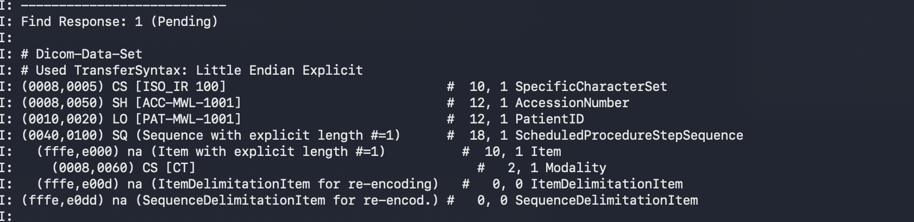

# HL7-to-DICOM Modality Worklist Lab

A local, synthetic integration lab that turns an HL7 `ORM^O01` radiology order
into an Orthanc DICOM Modality Worklist (MWL) entry. A simulated CT modality
then retrieves its scheduled procedure using DICOM C-FIND.

> **Safety:** all messages, identifiers, orders, and logs are synthetic. This
> teaching implementation is not suitable for clinical use or PHI.

## Architecture

```text
EHR -- ORM^O01 / MLLP --> HL7 bridge -- REST --> Orthanc Worklists plugin
                                                     ^
                                                     | MWL C-FIND
                                                CT_SIM modality
```

The [workflow diagram](docs/workflow.md) shows the accepted and rejected paths.
See [validation evidence](docs/validation.md) for reproducible expected output.
The [incident and recovery records](docs/incident-recovery.md) document the
symptom, root cause, test, remediation, and verification for each failure.

## HL7-to-DICOM mapping

| HL7 source | DICOM MWL tag | Example |
| --- | --- | --- |
| `PID-3` | `PatientID` | `PAT-MWL-1001` |
| `OBR-3` | `AccessionNumber` | `ACC-MWL-1001` |
| `ORC-2` | `RequestedProcedureID`, `ScheduledProcedureStepID` | `ORD-MWL-1001` |
| `OBR-4` | `RequestedProcedureDescription`, `ScheduledProcedureStepDescription` | CT Chest without contrast |
| Lab profile | `ScheduledProcedureStepSequence.Modality` | `CT` |

## Start the lab

```sh
docker compose up -d --build
python3 scripts/send_orm.py messages/orm_o01_ct_chest.hl7
```

The bridge replies with `ACK^O01^ACK` and `MSA|AA|ORM-MWL-001`. Confirm that
the worklist was created:

```sh
curl http://localhost:8046/worklists/?format=Simplify
```

## Simulate CT worklist C-FIND

The `mwl-client` service uses DCMTK `findscu` as a simulated CT modality. Its
calling AE Title is `CT_SIM`, which is registered in Orthanc.

```sh
docker compose --profile tools run --rm mwl-client \
  -v +sr -W -aet CT_SIM -aec ORTHANC_MWL \
  -k "0040,0100[0].0008,0060=CT" \
  -k "0010,0020=" -k "0008,0050=" orthanc-mwl 4242
```

The returned entry should include the synthetic PatientID, accession number,
and CT scheduled procedure. To show a modality mismatch, query `MR` instead of
`CT`; Orthanc returns no matching scheduled procedure:

### Visual validation evidence

The following screenshots are real local terminal output generated from the
synthetic fixture. The full, copyable transcript is in
[docs/validation.md](docs/validation.md).

#### C-FIND returns the scheduled CT procedure



#### Wrong called AE Title is rejected


```sh
docker compose --profile tools run --rm mwl-client \
  -v +sr -W -aet CT_SIM -aec ORTHANC_MWL \
  -k "0040,0100[0].0008,0060=MR" orthanc-mwl 4242
```

To test an AE Title error, change the called AE Title; the association should
be rejected because `DicomCheckCalledAet` is enabled:

```sh
docker compose --profile tools run --rm mwl-client \
  -v -W -aet CT_SIM -aec WRONG_AET \
  -k "0008,0050=*" orthanc-mwl 4242
```

## HL7 validation failure

```sh
python3 scripts/send_orm.py messages/invalid_missing_patient_id.hl7
```

Expected ACK:

```text
MSA|AE|ORM-MWL-BAD-001
ERR|||Missing PID-3 PatientID
```

## Tests and cleanup

```sh
python3 -m unittest discover -s tests -v
docker compose down
```

## Background

Orthanc's Worklists plugin turns Orthanc into a DICOM worklist server, can
store worklists in its database, and provides `POST /worklists/create` to
manage them. See the official [Worklists plugin documentation](https://orthanc.uclouvain.be/book/plugins/worklists-plugin-new.html).
